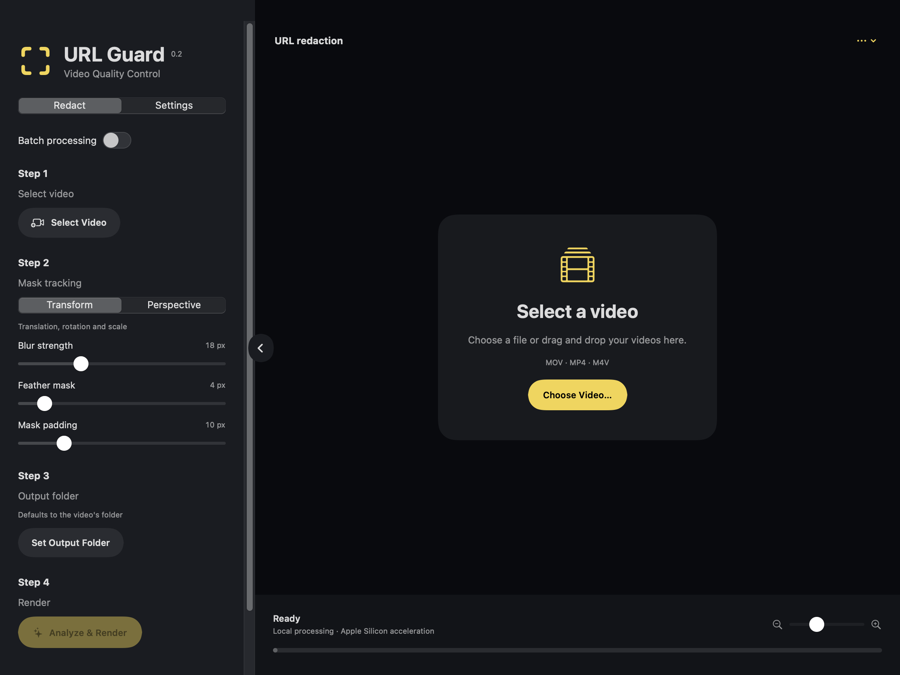

# URL Guard · Native video QC

A native **SwiftUI Mac app** with a **Rust processing engine**. Drag in videos, track URLs, render feathered polygon masks, and export editable Fusion tracking.



## Build and open

Requires macOS 13+, Xcode Command Line Tools, Rust 1.87+, CMake, and FFmpeg/ffprobe.

```sh
brew install rust cmake ffmpeg
bash scripts/build_macos.sh
open "dist/URL Guard.app"
```

The first build downloads and compiles a minimal OpenCV 4.12 dependency. Subsequent builds reuse it. The app bundles the Rust engine and statically linked OpenCV/SQLite. Apple frameworks provide OCR, rendering, and encoding. FFmpeg remains an external dependency for audio muxing and QC; Finder launches find Homebrew tools automatically.

## Native interface

The layout follows the supplied reference: collapsible left sidebar, Redact/Settings tabs, batch toggle, four workflow steps, output-folder picker, a large drag/drop preview canvas, and a bottom progress area. Native AVPlayer handles playback and seeking. Original/render switching and preview zoom are included. Processing runs outside the UI process.

- **Transform:** translation, rotation, and uniform scale. The mask stays an oriented quadrilateral.
- **Perspective:** OpenCV RANSAC homography. All four corners can move independently.
- **Feather:** Gaussian smoothing of polygon-mask edges, in output pixels. Zero gives a hard edge.
- **Padding and blur strength:** independent pixel controls.
- **Settings:** OCR cadence/confidence, sideways text, tracking threads, bitrate, and black/freeze/audio QC.

Batch jobs run sequentially. Each result folder is new; existing outputs are protected. Cancellation removes incomplete staged jobs.

Masks start on the first frame with a positive URL detection; they never extend into earlier frames. Forward tracking bridges OCR scans, and a negative scan ends the mask. Set **Settings → OCR every 1 frame** (CLI: `--scan-interval 1`) for detection on every frame. The default interval of eight can delay onset until the next scan and continue a tracked mask until the next scan confirms disappearance. This timing applies to rendered video and Fusion exports. Existing renders must be regenerated.

## Rust CLI and reusable core

```sh
target/release/video-qc doctor
target/release/video-qc blur input.mp4 --output output/my-clip \
  --tracking-type perspective --feather 6 --sigma 18 --padding 10
target/release/video-qc check input.mp4 --output qc.json
```

The CLI also accepts `--json-progress`, `--cancel-file`, `--scan-interval`, `--confidence`, `--threads`, `--bitrate-mbps`, `--no-sideways`, and `--no-qc`.

```rust
use video_qc::{process, Config, TrackingType};
use std::path::Path;

let settings = Config {
    tracking_type: TrackingType::Perspective,
    feather: 6.0,
    ..Config::default()
};
let report = process(
    Path::new("input.mp4"),
    Path::new("output/job"),
    &settings,
    |event| println!("{event}"),
)?;
```

The Rust crate separates configuration, geometry, tracking, OCR classification, storage, QC, rendering adapters, and Fusion export. Its current native media adapter uses macOS frameworks. The previous Python engine remains as an explicit reference/compatibility implementation; `video-qc-legacy` selects it. The normal Python `video-qc` entry point now forwards to Rust. Qt has been removed from the desktop path.

## Apple Silicon performance

- Apple Vision performs OCR with system-managed acceleration.
- Core Image runs blur, polygon masks, feathering, and compositing on **Metal**.
- AVFoundation/VideoToolbox encodes **hardware H.264**, with hardware encoding required.
- OpenCV uses **arm64/NEON** for optical flow, affine fitting, and homographies.
- Frames stream with one previous grayscale frame for tracking; samples live in indexed SQLite.

Measured native analysis: **19–22 fps** across the supplied clips. The first clip took **12.6–13.0 seconds**, versus **56.0 seconds** for the earlier Python job. Native rendering took about **1.0–1.4 seconds** per clip. These are complete local workload measurements, not a guarantee of real-time OCR. See [performance](docs/performance.md).

## Outputs and demos

Each result contains `blurred.mp4`, `tracking.json`, `tracking.sqlite`, `masks.fusion.lua`, `qc.json`, and `report.json`. Tracking schema 2 includes the **actual four-corner polygon** per frame, plus compatibility bounding boxes and presentation times.

All three test videos were rendered in **both tracking modes**, with 6 px feathering. [Watch the native comparisons and inspect tracking](demos/native/README.md). Independent verification found zero video timestamp error and identical audio payloads/timestamps in all six full-resolution renders.

## Resolve

```sh
python3 scripts/build_resolve.py
```

Copy both files from `dist/resolve` to a Resolve Workflow Integration/script folder. The panel now opens the Swift app. Fusion export uses animated **CornerPositioner → BitmapMask** graphs, stepped visibility, and feathering. The new graph was validated in a temporary composition on **Resolve 21.0.1.11**. [Installation and coordinate requirements](docs/resolve.md).

## Tests

```sh
cargo test --locked -- --test-threads=1
cargo clippy --all-targets --locked -- -D warnings
cargo fmt --check
URL_GUARD_ENGINE="$PWD/target/release/video-qc" swift test --package-path macos
uv run pytest -q
```

Hardware tests require access to Metal/VideoToolbox. The Swift integration test uses `URL_GUARD_ENGINE` to run a real render. Tests cover known projective motion, affine motion, mask feathering, render locality, orientation, variable timestamps, copied audio, cancellation, settings propagation, batch processing, progress framing, and compatibility behavior. See [validation details](docs/testing.md).

Rendering currently supports **8-bit SDR**. Small, distorted, occluded, or very brief URLs can be missed; review each render. Fusion imports need matching display dimensions and an unretimed clip. The native app/media backend target macOS; the legacy Python CLI remains available for other platforms. Platform-specific delivery certification and HDR mastering are outside this build.

Project license: [MIT](LICENSE). [Architecture](docs/architecture.md) · [Third-party notes](docs/third-party.md).
