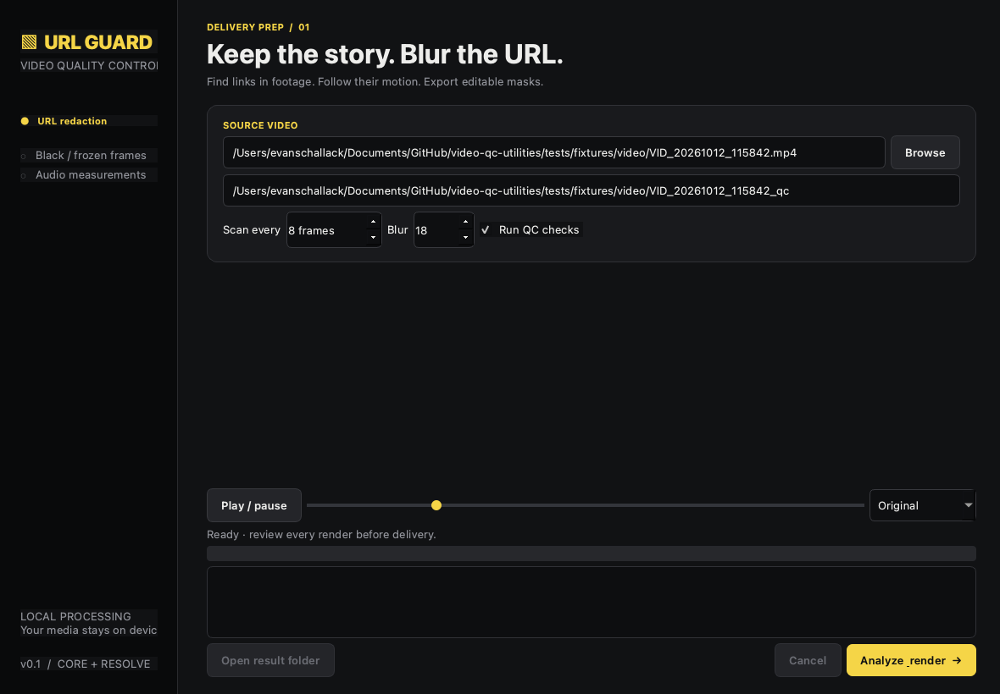

# URL Guard · Video QC utilities

Local URL detection, motion tracking, and blurring. A reusable Python engine, native Mac/Windows desktop UI, and DaVinci Resolve Workflow Integration script. Black and yellow throughout.



## Start

Requires Python 3.12+, [uv](https://docs.astral.sh/uv/), and FFmpeg/ffprobe on `PATH`.

```sh
# macOS
brew install ffmpeg uv

# Install the engine, desktop UI, and development tools.
uv sync --locked --extra gui
uv run video-qc doctor
uv run video-qc desktop
```

Windows: install FFmpeg with your package manager, add its `bin` directory to `PATH`, install uv, then run the same uv commands. Qt dependencies are optional: `uv sync --locked` installs the engine without the desktop shell. OCR models are bundled; jobs require no model downloads or cloud service.

## Blur a video

```sh
uv run video-qc blur input.mp4 --output output/my-clip
uv run video-qc check input.mp4 --output qc.json
```

The result folder must be new. Each completed job contains:

| Artifact | Purpose |
| --- | --- |
| `blurred.mp4` | Full-resolution H.264 SDR render, original audio streams copied |
| `tracking.json` | Versioned, timestamped URL boxes in display pixels |
| `tracking.sqlite` | Indexed per-frame tracking, suitable for large jobs |
| `masks.fusion.lua` | Editable animated RectangleMask and Blur nodes for Fusion |
| `qc.json` | Black/frozen-frame intervals, silence, LUFS, true peak |
| `report.json` | Settings, track counts, timings, review notices |

The desktop shell supports playback, seeking, original/render switching, progress, cancellation, and opening results. It runs the engine in a separate process.

## Rendered examples

All three supplied test videos have completed renders and tracking exports in [demos](demos/README.md). Comparison videos show **original on the left, blurred output on the right**.


```sh
# Reproduce the examples in a new folder.
uv run python scripts/showcase.py --output output/showcase
```

## Resolve extension

```sh
uv run python scripts/build_resolve.py
```

This prepares `dist/resolve/URL Guard.py` and its companion configuration. Copy both files to a Resolve script/plugin folder. See [installation and Fusion import](docs/resolve.md).

The panel opens the current clip in the native app, imports a completed render to the media pool, and imports animated masks onto the matching source clip. It uses Blackmagic's supported Python Workflow Integration mechanism. No proprietary bridge binary is redistributed.

The generated importer was exercised in a hidden temporary Fusion composition on **Resolve 21.0.1.11**. Mask positions, gap visibility, node creation, and MediaOut wiring passed. The built Resolve panel also loaded and closed successfully. See [validation](docs/testing.md).

## Use the engine from another application

```python
from video_qc import Config
from video_qc.pipeline import process

report = process(
    "input.mp4",
    "output/job-001",
    Config(scan_interval=8, threads=2),
    progress=lambda event: print(event),
    cancelled=lambda: False,
)
```

Native applications can call this API or consume newline-delimited JSON from `video-qc blur ... --json-progress`. A custom `Detector` can replace RapidOCR without changing tracking, rendering, or exports. See [architecture and contracts](docs/architecture.md).

## Performance and limits

OCR runs every eighth frame by default. OpenCV tracks every frame. One second of grayscale history supports backward tracking. SQLite keeps tracking off the heap; rendering blurs only detected regions. Models load once per job. ONNX/encoder thread counts are bounded.

These camera clips are an offline OCR workload. Current default measurements are roughly **5–6 analysis frames/second** on this machine. A faster upright-only configuration reduced the first clip's analysis to about **16 seconds for 217 frames**. This is not a real-time claim. See [measurements and tuning](docs/performance.md).

```sh
# Faster for known upright titles. Requires closer coverage review.
uv run video-qc blur input.mp4 --output output/fast \
  --scan-interval 16 --no-sideways --preset veryfast

# Dense OCR for brief URLs. More CPU work.
uv run video-qc blur input.mp4 --output output/dense --scan-interval 1
```

Review the entire render. Small, occluded, distorted, or briefly visible URLs can be missed. Some OCR errors resemble domains. Fusion masks need matching display dimensions and an unretimed clip. Rendering supports **8-bit SDR**, not HDR or 10-bit delivery masters. Platform delivery certification, subtitle checks, and platform-specific presets are not included.

## Test

```sh
uv run ruff check .
uv run ruff format --check .
uv run pytest -q --cov=video_qc
```

Tests cover real fixture OCR, optical-flow motion, region-only blur, variable timestamps, audio packet preservation, backward tracking, cancellation, QC filters, CLI events, desktop jobs, and Fusion coordinates/visibility. CI is configured for macOS, Windows, and Linux. Windows CI has not been run from this workspace.

Libraries: [RapidOCR](https://github.com/RapidAI/RapidOCR), [OpenCV](https://docs.opencv.org/), [PyAV](https://pyav.org/), [FFmpeg](https://ffmpeg.org/ffmpeg-filters.html), [tldextract](https://github.com/john-kurkowski/tldextract), [Typer](https://typer.tiangolo.com/), and [Qt/PySide](https://doc.qt.io/qtforpython-6/). Project license: [MIT](LICENSE). See [third-party notes](docs/third-party.md) before distributing an application bundle.
