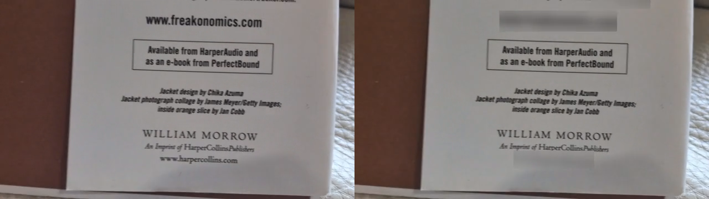
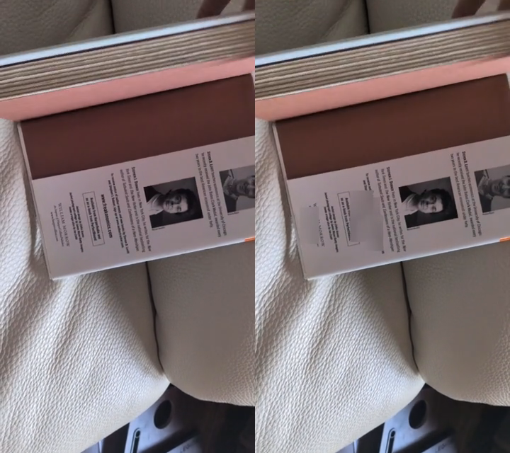
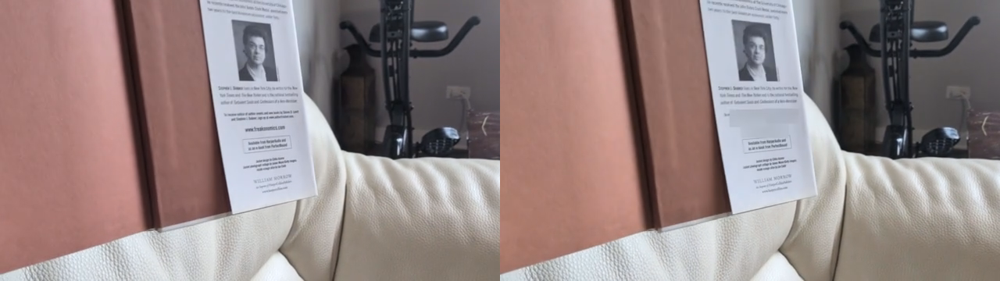

# Rendered demonstrations

Each supplied source has its own result folder. **Comparison: original left, blurred right.** Audio is retained. The full-resolution `blurred.mp4` is the output to inspect; comparison movies are resized for review.

| Clip | Comparison | Full render | Tracking | Fusion masks |
| --- | --- | --- | --- | --- |
| Moving close-up | [Video](VID_20261012_115842/comparison.mp4) | [MP4](VID_20261012_115842/blurred.mp4) | [JSON](VID_20261012_115842/tracking.json) | [Lua](VID_20261012_115842/masks.fusion.lua) |
| Sideways text | [Video](VID_20261012_115856/comparison.mp4) | [MP4](VID_20261012_115856/blurred.mp4) | [JSON](VID_20261012_115856/tracking.json) | [Lua](VID_20261012_115856/masks.fusion.lua) |
| Moving wider shot | [Video](VID_20261012_115919/comparison.mp4) | [MP4](VID_20261012_115919/blurred.mp4) | [JSON](VID_20261012_115919/tracking.json) | [Lua](VID_20261012_115919/masks.fusion.lua) |

`summary.json` contains measured timings. Each folder also contains `tracking.sqlite`, `qc.json`, and `report.json`. `verification.json` records independent frame/timestamp/audio comparisons. Track counts include reacquisition segments and OCR variants; they are not counts of unique domains.

OCR is imperfect. Some tiny text can remain visible and some erroneous domain-like text can receive a mask. Backward/forward motion extends valid detections, but it cannot recover URLs that are never recognized. Review every frame before delivery and adjust masks in Fusion as needed.

Reproduce with `uv run python scripts/showcase.py --output output/new-demos`. Existing output folders are protected against overwrite.
