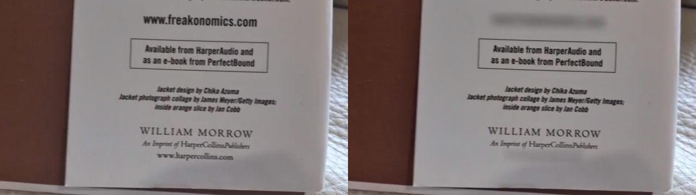
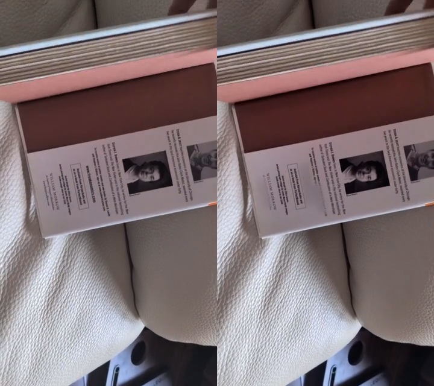
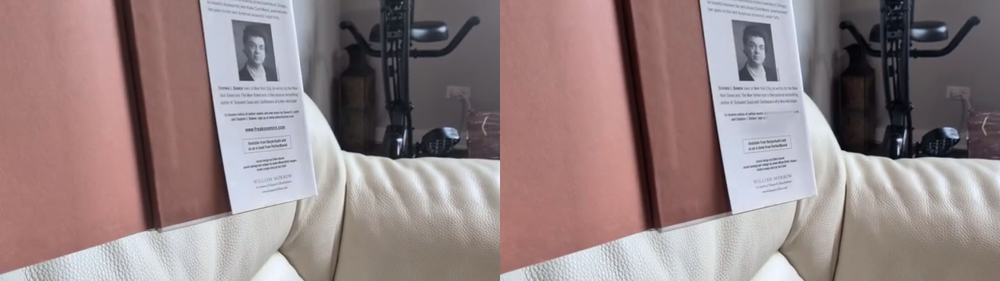

# Native rendered demos

Three provided clips, two tracking modes, **6 px mask feathering**. Original appears on the left; native output appears on the right.

| Clip | Transform comparison | Perspective comparison |
| --- | --- | --- |
| Moving close-up | [Video](VID_20261012_115842/transform/comparison.mp4) | [Video](VID_20261012_115842/perspective/comparison.mp4) |
| Sideways text | [Video](VID_20261012_115856/transform/comparison.mp4) | [Video](VID_20261012_115856/perspective/comparison.mp4) |
| Wider moving shot | [Video](VID_20261012_115919/transform/comparison.mp4) | [Video](VID_20261012_115919/perspective/comparison.mp4) |





Each mode folder includes the full-resolution `blurred.mp4`, `tracking.json`, `tracking.sqlite`, `masks.fusion.lua`, `qc.json`, and `report.json`. JSON includes actual quadrilateral samples; Lua builds editable four-corner masks with feathering.

`summary.json` records timings. `verification.json` records exact frame/timestamp/audio comparisons. `resolve-validation.txt` records real-host mask checks. `swift-ui.png` is the native app screenshot.

```sh
python3 scripts/native_showcase.py --output output/new-native-demos
```

Review the full render. Tiny/occluded text and uncertain OCR remain limitations. Track counts include reacquisition segments, not unique domains.
