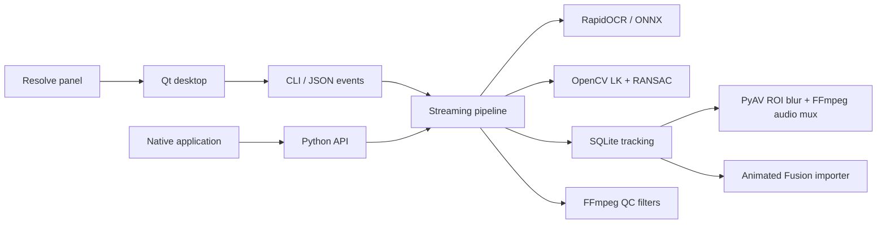

# Engine and adapter contracts

The engine lives in `src/video_qc`. It imports no Qt or Resolve code. `desktop.py` is optional and loaded only by the desktop entry point. The Resolve adapter imports only the host Python standard library and launches the engine's own environment.

## Modules

| Module | Responsibility |
| --- | --- |
| `models` | Validated immutable configuration and detector protocol |
| `urls` | URL candidate syntax and offline public-suffix classification |
| `ocr` | Shared ONNX sessions, perpendicular text pass, character-level URL bounds |
| `media` | ffprobe metadata, display rotation, timestamped decoding, cancellable child processes |
| `tracking` | Sparse LK flow, backward consistency, local affine RANSAC, track association |
| `store` | Disk-backed samples and streaming JSON export |
| `render` | Padded region blur, VFR timestamps, audio stream copying |
| `fusion` | Bottom-left normalized coordinates, time mapping, editable masks |
| `qc` | FFmpeg blackdetect, freezedetect, silencedetect, loudnorm measurements |
| `pipeline` | Job lifecycle and completed result publication |

## Detector

Implement `detect(image: numpy.ndarray) -> list[Detection]`. Input is BGR uint8 in display orientation. Detection boxes are `(x, y, width, height)` in the same full-resolution display coordinates. Confidence ranges from zero to one. Return a fresh list and fresh detections each call; the tracker updates its own detection objects.

RapidOCR supplies character boxes. URL spans use those boxes; the complete text-line box is the fallback when character alignment is unavailable. Recognized `www.`/HTTP prefixes are accepted even when OCR corrupts the domain suffix. Bare domains use tldextract's bundled public suffix snapshot. Email redaction is outside this detector's scope.

## Pipeline

Analysis decodes sequentially. OCR runs at a configurable cadence and on strong scene changes. Half-resolution grayscale frames drive optical flow. Forward/backward consistency and RANSAC reject unstable motion. Oriented quadrilaterals are retained internally to avoid repeated rectangle inflation. Exports use conservative axis-aligned bounds.

A bounded history enables new detections to propagate backward. Reliable forward motion can bridge OCR misses for two seconds by default. Tracks end when motion fails, the hold duration expires, or a cut is detected. Histories are cleared at cuts. Hard cuts, fades, severe motion blur, and prolonged occlusion still need review.

Analysis writes SQLite incrementally. A second sequential pass renders masks. JSON and Lua export stream database rows. A temporary sibling folder receives the job; a completed folder is published after all outputs succeed. Existing results are rejected. Cancellation or an exception removes the staged job. An externally forced kill can leave a `.video-qc-*` staging folder.

Memory is bounded by current frames, OCR sessions, and the configured history. Export sizes grow with duration and URL count. Fusion itself loads each track's animation samples while importing; very long imports can require substantial host memory.

## Timing and coordinates

Decoded presentation timestamps are normalized to the first video frame. Rendering keeps relative source PTS and the source time base. Display rotation is baked into the image; the output has no rotation tag. Audio timestamps are shifted by the source video start time, then stream-copied. MP4 movie timescale is 720000, compatible with common 90 kHz video and 48 kHz audio clocks.

Tracking JSON has `schema_version: 1`, `frame_origin: 0`, and `coordinates: display_pixels_top_left`. A track has an ID, recognized URL, OCR confidence, and ordered samples. Each sample has `frame`, `seconds`, `box`, and `method` (`ocr`, `flow`, or `backfill`). Confidence is the initial OCR confidence for the track, not a per-frame tracking score. Track IDs identify continuous tracking segments, not unique domain names.

Fusion converts `seconds * timeline_fps` to integer composition frames. Center Y is flipped; width and height are normalized independently. Padding matches the rendered ROI. Mask Level uses stepped keys, including disabled guard frames, so missing intervals stay unmasked. Fusion blur strength is editable and uses Fusion's units; it is not a pixel-identical copy of OpenCV's Gaussian.

## Process interface

`video-qc blur SOURCE --output DIRECTORY --json-progress` writes one JSON object per line on stdout. Diagnostics go to stderr. Progress objects contain `stage`, `frame`, `seconds`, and `duration`. Stages are `analyze`, `render`, `qc`, and `complete`, followed by a `result` object containing the report.

Exit status: zero for a completed result, one for a failed job, 130 for cancellation. `--cancel-file PATH` cancels when the marker exists; the caller owns marker cleanup. This works for Windows console subprocesses as well as macOS. SIGINT/SIGTERM also cancel the CLI on supported systems.

Python callers can inject `progress` and `cancelled` callbacks. Cancellation is checked between frames and while waiting for media children. OCR inference already in progress finishes before cancellation is observed. Use one detector per concurrent job. For multiple jobs, use separate worker processes to isolate codec/model state and bound CPU use.
