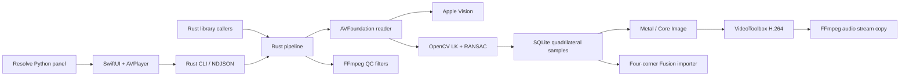

# Native architecture

## Boundaries

`macos/Sources/URLGuardKit` owns settings, job state, batch queues, cancellation, and the asynchronous process protocol. `URLGuardApp` owns SwiftUI views and native file panels. AVPlayer previews media without copying decoded pixels into SwiftUI.

The UI launches a bundled Rust executable. Standard output is newline-delimited JSON; diagnostics use stderr. Blocking pipe reads and process waits run on a background queue. Only model updates run on the main actor. Cancellation uses a marker file, allowing Rust to clean up staged outputs instead of terminating it abruptly.

`rust/src` contains the reusable Rust library and CLI. Modules separate validation, geometry, URL classification, tracking state, media commands, persistent samples, QC, Fusion export, and job orchestration. `native.rs` provides owning RAII wrappers around Apple framework handles. Readers/writers are deliberately not shared across threads.

`rust/native/apple.mm` is a thin Objective-C++ adapter to AVFoundation, Vision, Core Image, Metal, and VideoToolbox. It is not a second job engine. `tracking.cpp` invokes established OpenCV implementations. OpenCV is built statically with only the required modules and its arm64 NEON implementation.

The current native media adapter is macOS-specific. Portable configuration/geometry/storage/protocol code remains separate from this adapter. Other media platforms need their own reader/OCR/renderer implementation. The old Python engine is retained for comparison and existing callers, with an explicit `video-qc-legacy` command.

## Tracking models

Both modes retain four-corner polygons. Optical flow uses grayscale images at half display resolution, up to 100 feature points, a pyramidal LK window, and forward/backward consistency checks.

Transform uses `estimateAffinePartial2D`: translation, rotation, uniform scale. Perspective uses `findHomography`: an eight-parameter projective transform. It requires at least eight reliable features, RANSAC consensus, and reasonable resulting polygon area. Nonfinite, inverted, degenerate, or offscreen results are rejected. Full OCR scans refresh detections; reliable flow bridges the frames between scans. An OCR scan retires tracks it does not confirm, even when the background remains trackable.

New detections begin on the positive OCR frame. There is no backward propagation or speculative pre-roll. Only the previous grayscale frame is retained for forward tracking. Cuts clear tracking. Samples are written incrementally to SQLite. JSON and Fusion exports stream database rows. A second pass renders using the stored geometry. Source frames are never accumulated for the full clip. An interval of one runs OCR on every frame; larger intervals trade precise onset/disappearance confirmation for fewer OCR passes. The former native `lookback_seconds` configuration field was removed; old serialized configurations may contain it, but it has no effect.

## Masks

Padding offsets each polygon edge outward and intersects neighboring offset edges. It preserves the tracked shape. Metal builds a white projective polygon against black, unions overlaps with maximum compositing, then applies the configured Gaussian feather. Feather zero disables edge smoothing. Image blur and mask feather are separate parameters.

The renderer creates one Metal-backed Core Image context per native reader/writer session. CVPixelBuffer/IOSurface buffers carry frames to hardware H.264 encoding. Hardware encoding is required; unsupported hardware fails instead of silently switching to a slow encoder.

## Coordinates and timing

Source rotation is baked into display-oriented frames. AV track transforms use top-left image axes; the native adapter converts these to Core Image's bottom-left axes. Grayscale tracking rows and exported polygons use top-left display coordinates. Character-level Vision bounds select URL spans where available.

Tracking schema 2 contains `quad: [[x,y], ...]` in cyclic corner order and a compatibility `box: [x,y,width,height]`. Each sample includes frame index, seconds, and method (`ocr`, `flow`). Historical renders may contain `backfill` samples; new renders do not. Track IDs identify continuous tracking segments, not unique domains. Reappearance after a negative scan starts a new segment.

Video timestamps are normalized to the first decoded frame. AVAssetWriter uses a 720000 Hz media/movie timescale to preserve the source's common video/audio clocks. Audio is shifted relative to the source video start and stream-copied by FFmpeg. All six fixture renders were independently verified for frame/timestamp/audio preservation.

Fusion flips Y and normalizes coordinates. It maps seconds to composition frames and applies the configured trim offset. Four independent Path modifiers drive CornerPositioner; BitmapMask selects Alpha and applies SoftEdge. Stepped Level keys disable mask gaps. Fusion blur/SoftEdge use the host's units and kernels, so appearance is editable rather than pixel-identical to Core Image.

## Completion and failures

A sibling temporary directory receives outputs. The directory is renamed only after all artifacts succeed. Existing result folders are rejected. Errors/cancellation drop native handles, close SQLite, and remove staged results. A forced external kill can leave a `.video-qc-*` staging folder.

Exit codes: 0 completed, 1 failed, 130 cancelled. Progress stages: `analyze`, `render`, `qc`, `complete`, then `result` with the report. Native inference already in flight finishes before the next cancellation check.
